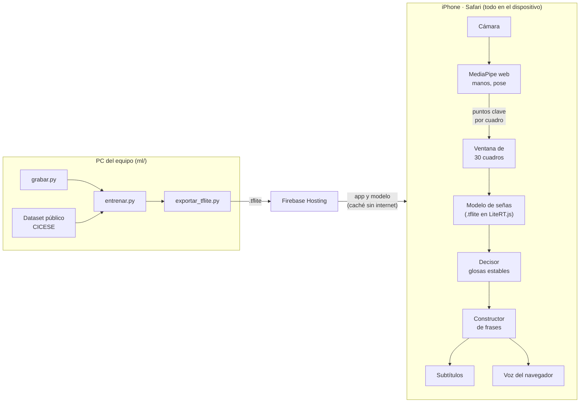

# SignCast

Traduce Lengua de Señas Mexicana (LSM) a texto y voz en tiempo real, sin internet. Es una aplicación web (PWA) hecha con Flutter web: corre en el navegador del iPhone, se instala en la pantalla de inicio y, después de la primera carga, funciona sin conexión. La cámara y MediaPipe detectan manos, pose y gestos en el propio dispositivo; el video nunca sale de él.

Reconoce 27 señas del aula universitaria (HOLA, MAESTRO, TAREA, ENTENDER…), las 27 letras del alfabeto y 13 frases ([docs/frases.md](docs/frases.md)).

## Arquitectura



- **`ml/`** (Python): graba señas, extrae puntos clave con MediaPipe, entrena el modelo y lo exporta a TensorFlow Lite.
- **`app/`** (Flutter web): detecta los puntos en el navegador con el mismo vector de características que `ml/` ([docs/formato_puntos_clave.md](docs/formato_puntos_clave.md)), corre el `.tflite` con LiteRT.js y arma la frase.
- **Firebase Hosting** sirve la app y el modelo; un service worker los guarda para usarlos sin internet. Un modelo nuevo se publica sin reinstalar la app.

La app empezó como Android nativo y se pasó a web en el #47 (todo el equipo usa iPhone y no hay Mac para compilar iOS). El código de Android se quitó del repo en el PR #50; quedó como referencia en el historial de git y se recupera con `git checkout 21e7d8e^ -- app/android`.

## Estructura

| Carpeta | Qué hay |
|---|---|
| `app/` | La aplicación (Flutter web, PWA): pantallas, constructor de frases, MediaPipe web y service worker. Ver [app/README.md](app/README.md) |
| `ml/` | Python: grabación de señas, extracción de puntos clave, entrenamiento y exportación a TensorFlow Lite |
| `ml/signcast/` | Los scripts (`grabar.py`, `entrenar.py`, `exportar_tflite.py`, `tiempo_real.py`…) |
| `ml/tests/` | Pruebas de `ml/` (`pytest`) |
| `ml/vocabulario.csv` | Señas y letras, y a qué modelo pertenece cada una |
| `data/` | Datos de entrenamiento (no van al repo, ver [data/README.md](data/README.md)) |
| `modelos/` | Modelos entrenados (no van al repo; se comparten por Drive) |
| `docs/` | Vocabulario y frases, formato del vector de puntos clave, resultados, nube y publicación |

## Instalación

### `ml/` (Python 3.12)

```
cd ml
python -m venv .venv
.venv\Scripts\activate
pip install -r requirements.txt
python -m signcast.descargar_modelos   # modelos de MediaPipe
python -m pytest -q                    # pruebas
```

Los datos se bajan de la carpeta de Drive del equipo a `data/` ([docs/nube.md](docs/nube.md)).

### App web (Flutter)

Necesita Flutter (canal estable) y Node.js. Desde `app/`:

```
powershell -ExecutionPolicy Bypass -File tool\preparar_mediapipe_web.ps1   # solo la primera vez
powershell -ExecutionPolicy Bypass -File tool\preparar_litert_web.ps1      # solo la primera vez
flutter pub get
flutter run -d chrome                                   # correr en local
flutter run -d chrome --dart-define=DEMO=true           # sin modelo, con frases de prueba
flutter test                                            # pruebas
```

El modelo real necesita `modelo.tflite` y `etiquetas.txt` en `app/assets/modelos/` ([docs/modelo_navegador.md](docs/modelo_navegador.md)).

**Compilar y publicar** en Firebase Hosting (necesita `npm install -g firebase-tools` y `firebase login`):

```
powershell -ExecutionPolicy Bypass -File tool\publicar_web.ps1 -SoloConstruir   # solo compilar
powershell -ExecutionPolicy Bypass -File tool\publicar_web.ps1                  # vista previa (7 días)
powershell -ExecutionPolicy Bypass -File tool\publicar_web.ps1 -Produccion      # sitio principal
```

**Abrir en un iPhone:** abrir la URL en Safari con internet, esperar a que cargue, Compartir > Agregar a pantalla de inicio y aceptar el permiso de la cámara. Detalles en [docs/publicar_web.md](docs/publicar_web.md).

## Del dato al modelo

Un comando por paso, desde `ml/` con el venv activado:

| Paso | Comando |
|---|---|
| 1. Grabar una seña | `python -m signcast.grabar --persona <nombre> --glosa HOLA` |
| 1. Grabar una frase | `python -m signcast.grabar --persona <nombre> --frase "YO NO ENTENDER" --repeticiones 10` |
| Ver qué falta grabar | `python -m signcast.progreso --persona <nombre>` |
| 2. Convertir el dataset público | `python -m signcast.convertir_publico estaticas --origen <carpeta>` y `... dinamicas --origen <carpeta>` |
| 3. Entrenar (evaluando con una persona fuera) | `python -m signcast.entrenar --tarea senas --reducir-columnas --persona-prueba <nombre>` |
| 3. Entrenar el modelo final | `python -m signcast.entrenar --tarea senas --sin-prueba --reducir-columnas` |
| 3. Entrenar el alfabeto | `python -m signcast.entrenar --tarea alfabeto --persona-prueba <nombre>` |
| 4. Exportar a TFLite | `python -m signcast.exportar_tflite --modelo ..\modelos\senas_transformer` |
| 5. Probar en tiempo real (PC) | `python -m signcast.tiempo_real --modelo ..\modelos\senas_transformer` |

El modelo de señas predeterminado es un Transformer; `--arquitectura lstm` entrena el LSTM. Después de exportar, `modelo.tflite` y `etiquetas.txt` se copian a `app/assets/modelos/`.

## Resultados

Probando con una persona que el modelo no vio al entrenar:

| Modelo | Exactitud | F1 macro | Meta (85 % / 0.80) |
|---|---:|---:|:---:|
| Alfabeto (MLP) | 0.945 | 0.943 | sí |
| Señas (Transformer) | ~0.73 (promedio de 3 personas) | ~0.69 | no |

Con solo tres firmantes en el equipo, las señas no llegan a la meta con una persona nueva. Detalle, comparación LSTM vs Transformer y efecto del aumento de datos: [docs/resultados.md](docs/resultados.md).

## Diseño de la interfaz

Prototipo de la app en Figma (cámara con subtítulos, estado de detección, ajustes e historial de frases):
https://prism-mace-81782658.figma.site

## Nube

Los datos se comparten en una carpeta de Google Drive y el modelo se distribuye con Firebase (plan Spark). Estructura de la carpeta, accesos, cómo subir y bajar archivos y dónde se entrena: [docs/nube.md](docs/nube.md).

## Créditos

- **Dataset de LSM de CICESE:** López-Nava et al., 2026, licencia [CC-BY 4.0](https://creativecommons.org/licenses/by/4.0/). Letras estáticas: https://doi.org/10.5281/zenodo.10067509 · letras dinámicas: https://doi.org/10.5281/zenodo.14689869
- **[MediaPipe](https://ai.google.dev/edge/mediapipe)** (Google, Apache 2.0): detección de manos, pose y rostro, en Python y en el navegador.
- **[LiteRT.js](https://ai.google.dev/edge/litert)** (Google, Apache 2.0): corre el modelo `.tflite` en el navegador.
