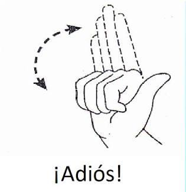
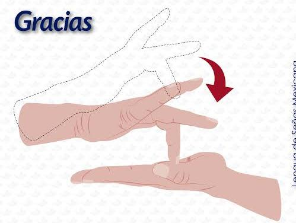
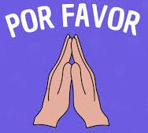
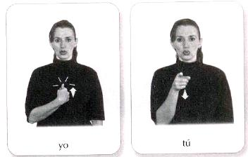
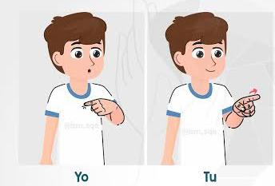
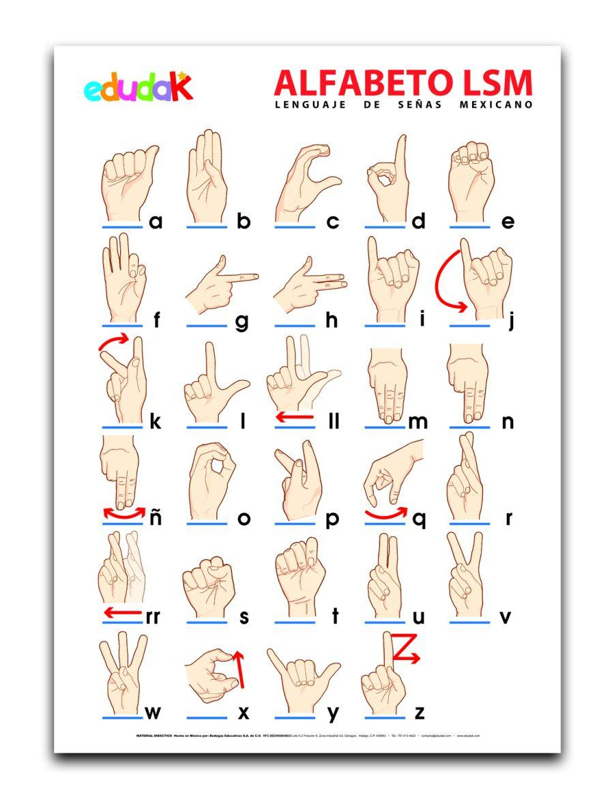

# Referencias de las señas del vocabulario

Fuente de verdad del vocabulario: `ml/vocabulario.csv`. Aquí se anota, para cada seña,
dónde verla (video o imagen) y cómo hacerla (issues #10 y #11).

Las imágenes están en `docs/img/`.

## Señas (27)

### Saludos y cortesía

| Glosa | Cómo se hace / referencia |
|-------|---------------------------|
| HOLA | https://www.tiktok.com/@amy_lsm/video/7396377812736822534 |
| ADIOS | Mano abierta que se cierra y se mueve en arco.      |
| GRACIAS | Con el dedo medio se toca la palma de la otra mano, una y otra vez.    |
| POR-FAVOR | Manos juntas, como rezando o rogando.    |
| SI | https://www.tiktok.com/@lailag92/video/6998174583136275718 (SI y NO) |
| NO | https://www.tiktok.com/@lailag92/video/6998174583136275718 (SI y NO) |

### Personas

| Glosa | Cómo se hace / referencia |
|-------|---------------------------|
| YO |   |
| TU | Misma referencia que YO (la segunda seña de cada imagen). |

### Aula

| Glosa | Cómo se hace / referencia |
|-------|---------------------------|
| MAESTRO | https://www.tiktok.com/@lsmcesar/video/7634985746767547669 (solo la seña de maestro, sin deletreo) |
| COMPANERO | https://www.tiktok.com/@richi_te_en.sena/video/7280398424241884422 (sin deletreo; solo la primera seña) |
| CLASE | https://www.tiktok.com/@lsm_sqe/video/7457735689279474949 |
| TAREA | https://www.youtube.com/watch?v=WMUhSW5PRzQ |
| EXAMEN | https://www.tiktok.com/@juan_hernandez_cruz_ils/video/7507110100276940038 |
| PREGUNTA | https://www.tiktok.com/@amy_lsm/video/7396372171343334662 (aparece primero en ese video) |

### Verbos

| Glosa | Cómo se hace / referencia |
|-------|---------------------------|
| ENTENDER | https://www.tiktok.com/@lsm_sqe/video/7597917188586048776 (la primera seña del video) |
| REPETIR | https://www.instagram.com/reel/DcADMc3IpSF/ |
| AYUDAR | https://www.tiktok.com/@richi_te_en.sena/video/7249167910608833798 |
| PODER | https://www.tiktok.com/@fueraluces/video/7234882623594630405 |
| IR | https://www.tiktok.com/@dbriian16/video/6986423273152187654 |
| TENER | https://www.tiktok.com/@hecape64/video/7457411714527612165 |

### Lugar, preguntas y tiempo

| Glosa | Cómo se hace / referencia |
|-------|---------------------------|
| BANO | https://youtu.be/lCWBx15Kcn4 |
| QUE | https://www.tiktok.com/@amy_lsm/video/7396372171343334662 (orden en el video: pregunta, qué, cómo, cuándo, dónde) |
| COMO | Mismo video que QUE |
| CUANDO | Mismo video que QUE |
| DONDE | Mismo video que QUE |
| HOY | https://www.facebook.com/share/v/1KoUm9obzS/ (las dos primeras señas: hoy, mañana) |
| MANANA | https://www.facebook.com/share/v/1KoUm9obzS/ (las dos primeras señas: hoy, mañana) |

### Control

| Glosa | Cómo se hace |
|-------|--------------|
| _REPOSO | Manos abajo y relajadas, sin hacer ninguna seña |

## Alfabeto (27 letras)

- 21 estáticas: A B C D E F G H I L M N O P R S T U V W Y
- 6 con movimiento: J K Ñ Q X Z (hacer el movimiento completo dentro de la toma de 1.5 s)
- En el comando la Ñ se escribe con Ñ (`--glosa Ñ`); es la única letra con esa grafía.

Lámina "Alfabeto LSM" de Edudak. Las flechas rojas indican el movimiento de J, K, Ñ, Q,
X y Z (y de LL y RR, que no están en el vocabulario).

